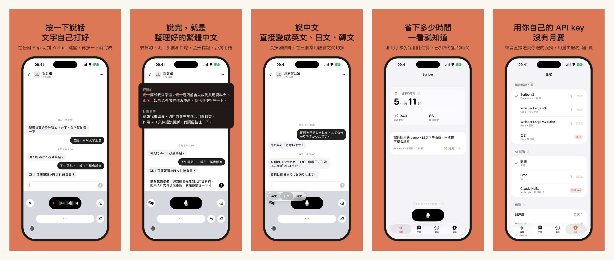

# Scriber

開源的語音輸入工具：iOS 鍵盤與 App，加上 macOS 選單列 App。說話，就變成整理好的繁體中文。

An open-source voice dictation tool for iOS (keyboard + app) and macOS (menu-bar app), tuned for Traditional Chinese (Taiwan). Bring your own API key; there is no backend.



## 特色

- **自備 API key，沒有後端**：錄音直接從你的裝置送到你選的服務。開發者收不到任何資料，沒有追蹤、沒有分析工具。見 [隱私權政策](docs/PRIVACY.md)。
- **輸出一律繁體、台灣用語**：內建 OpenCC 轉換，簡體結果自動轉成繁體。
- **辨識引擎**：ElevenLabs Scribe v3（含即時顯示）、Groq Whisper Large v3／Turbo、自訂的 OpenAI 相容服務。
- **AI 處理（選用）**：潤飾、翻譯、說話改字，用 Groq 或 Anthropic 的 key。不開也能用，文字整理在裝置上完成。
- **模式**：把引擎、提示詞、輸出方式存成模式，用快捷鍵切換，或依目前的 App 自動套用（macOS）。
- **檔案轉錄**：任意長度的音檔或影片轉成逐字稿，可匯出純文字、Markdown、SRT。
- **個人字典**、歷史紀錄、標點規則。

## 平台

| | 最低版本 | 說明 |
|---|---|---|
| iOS | 17.0 | 鍵盤沒有打字按鍵，只有麥克風。鍵盤要開「允許完整取用」才能跟 App 溝通 |
| macOS | 14.0 | 選單列 App，沒有沙盒。輔助使用權限是選用的（自動貼上、單鍵快捷鍵） |

## 編譯

需要 Xcode 27 以上和 [XcodeGen](https://github.com/yonaskolb/XcodeGen)。

```sh
brew install xcodegen
xcodegen generate
open Scriber.xcodeproj
```

專案檔由 `project.yml` 產生，沒有放進版本控制。

**簽署**：`project.yml` 裡的開發團隊、套件識別碼（`com.geekaz.Scriber…`）、App Group（`group.com.geekaz.Scriber`）和 Keychain 群組是作者的。要裝到自己的裝置，請換成你自己的。

**測試**

```sh
cd Packages/ScriberCore && swift test
xcodebuild test -project Scriber.xcodeproj -scheme ScriberMacTests
```

需要真實 API key 的測試預設略過。

## 使用

1. 開啟 App，在設定裡填入至少一個辨識服務的 API key。Groq 有免費額度，門檻最低；Scribe v3 最準。
2. **iOS**：設定 → 一般 → 鍵盤 → 新增鍵盤 → Scriber，並開啟「允許完整取用」。
3. **macOS**：預設快捷鍵是 ⌥Space，點一下開始、再點一下結束。

key 只存在裝置的鑰匙圈。

## 專案結構

| 路徑 | 內容 |
|---|---|
| `App/` | iOS 主 App（錄音在這裡，鍵盤擴充功能不能用麥克風） |
| `Keyboard/` | iOS 鍵盤擴充功能 |
| `Mac/` | macOS 選單列 App |
| `Packages/ScriberCore/` | 共用核心：辨識、AI 處理、繁體轉換、模式、檔案轉錄 |
| `MacSnapshots/` | 把 Mac 介面算成圖片的測試，用來檢查畫面 |
| `docs/` | 產品文件（PRD、隱私權政策、上架資料） |

`docs/` 裡的 PRD 是開發過程的紀錄，保留了當時的討論和決定。

## 授權

程式碼以 [MIT](LICENSE) 授權。

第三方資源：
- 簡繁轉換字典來自 [OpenCC](https://github.com/BYVoid/OpenCC)（Apache-2.0），見 `Packages/ScriberCore/Sources/ScriberCore/Resources/OpenCC/`。
- macOS 的提示音來自 Kenney 的 [Interface Sounds](https://kenney.nl/assets/interface-sounds)（CC0），見 `Mac/Resources/Sounds/NOTICE.md`。

## 回報問題

請到 [Issues](https://github.com/Kazzx9921/Scriber/issues)。App 內的診斷紀錄不含說話內容和 key，可以直接貼上。
